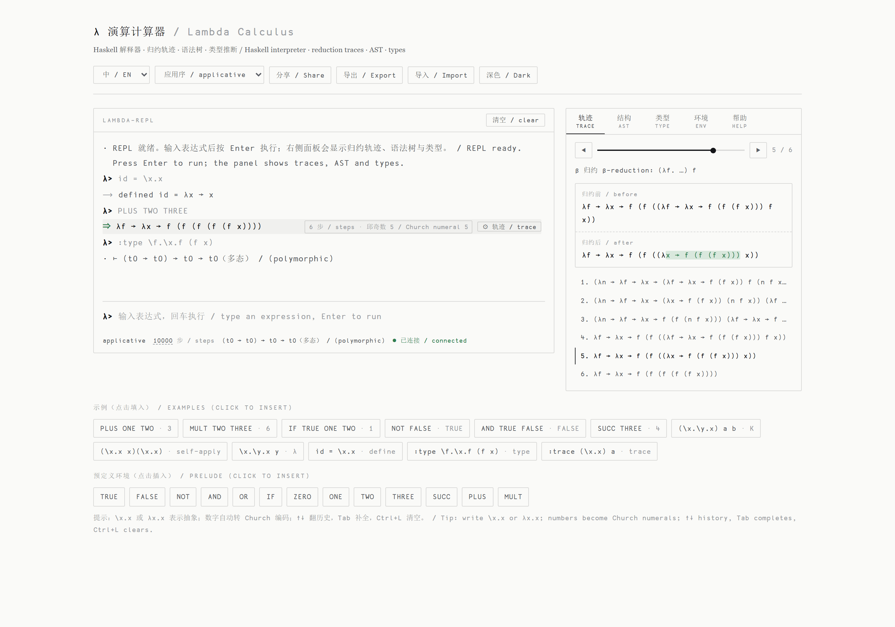
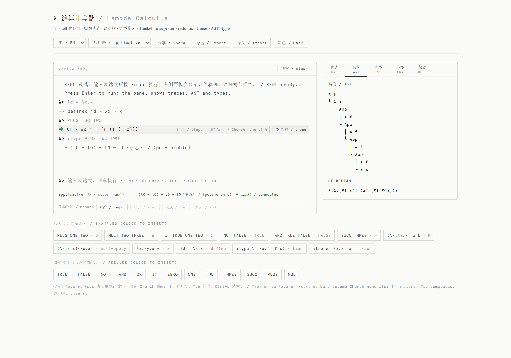
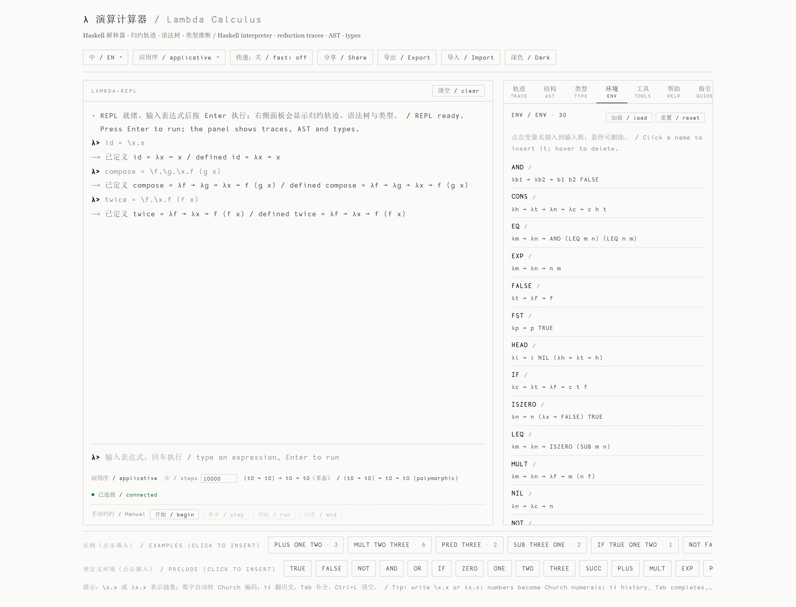
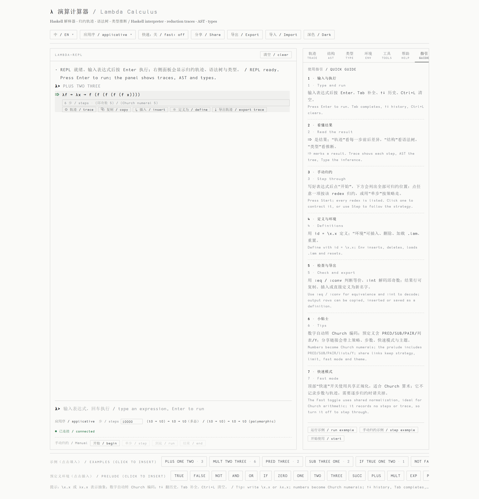

# 支持邱奇数编码的 Lambda 演算解释器（[English](./README.md)）

一个 Haskell 实现的纯 lambda 演算解释器：邱奇数/邱奇布尔值、无捕获替换、
归约轨迹、四种求值策略、简单类型推断，以及一个轻量的定义环境。提供两个
独立可执行程序：

- `main` —— 最小核心 REPL。
- `extension` —— 支持定义、文件加载、归约轨迹、语法树 / de Bruijn 视图、
  类型推断，以及供网页使用的批处理 / JSON 模式；输出中英双语。

## 功能特点

- **纯 lambda 演算**：α 等价、无捕获替换。
- **归约轨迹**：记录每一次 β 归约的前后形态。
- **四种求值策略**：应用序、正规序、按名调用、按值调用（后两者为弱策略，
  停在弱首正规形）。
- **步数上限**（默认 10000）：不终止的项给出提示，而不是卡死。
- **语义提示**：按 α 等价识别邱奇数 / 布尔值 / 序对，以及 `I K S B C W` 组合子。
- **简单类型**：Hindley–Milner 推断，支持 let 泛化（`:type`）。
- **定义环境**：`name = expr`、`:load`、`:env`、`:del`、`:reset`。
- **两种视图**：语法树（`:ast`）与 de Bruijn 索引（`:db`）。
- **中英双语**：所有面向用户的文本都有中英两种形式；用
  `--lang zh|en|both` 或 `:lang` 切换（默认 `both`）。

## 界面截图

浅色主题，取自实际运行的网页界面。



*归约轨迹：每一步的归约前后差异、步进播放器，结果附带 β 步数与邱奇数释义。*



*结果的语法树，以及绑定变量的 de Bruijn 索引视图。*



*环境面板：列出定义及其表达式；点击名称插入，悬停删除。*



*内置使用指引在首次访问时打开，也可随时从「指引」标签页查看。*

在网页界面运行时重新生成截图：

```bash
pip install -r tools/requirements.txt
python tools/screenshot.py            # 或 tools\screenshot.bat
```

## 编译

```bash
./build.sh      # Linux / macOS
build.bat       # Windows
```

两者都以 `ghc -O2 ... -threaded -rtsopts` 编译；Windows 脚本额外传入
`-package containers -package haskeline`。

## 使用方法

```bash
./extension [--lang zh|en|both] [--batch] [--json] [-h|--help] [文件]
```

若给出文件，启动 REPL 前会先加载其中的 `name = expr` 定义。

### REPL 命令

| 命令 | 说明 |
| --- | --- |
| `:help` | 显示帮助 |
| `:load <文件>` | 加载定义（每行 `name = expr`） |
| `:let name = expr` | 定义变量 |
| `:env` / `:del <名字>` / `:reset` | 查看 / 删除 / 重置环境 |
| `:strategy applicative\|normal\|cbn\|cbv` | 切换求值策略 |
| `:steps <n>` | 设置归约步数上限 |
| `:trace <表达式>` | 打印完整归约轨迹 |
| `:ast <表达式>` / `:db <表达式>` | 语法树 / de Bruijn 索引 |
| `:type <表达式>` | 推断简单类型 |
| `:begin <表达式>` / `:step` / `:run` / `:end` | 交互式单步归约 |
| `:lang zh\|en\|both` | 切换输出语言 |
| `:q` | 退出 |

### 语法

- 变量：以字母或 `+ - * / % ^ ? ! < > | & ~ # $` 之一开头，后续可含字母、
  数字、`_`、`'` 或运算符。
- 抽象：`λx.body` 或 `\x.body`；多参数写为 `λx y.body`。
- 应用：`f a`，左结合；括号：`(expr)`。
- 数字：`0`…`9999` 自动转为邱奇数。
- 定义：`name = expression`。

### 示例

```text
λ> PLUS ONE TWO
⇒ λf → λx → f (f (f x))  (6 步)  (邱奇数 3)

λ> :trace (\x.\y.x) y
1. β 归约: (λx. …) y  （先 α-重命名避免变量捕获）
2. λy' → y

λ> :type \f.\x.f (f x)
类型：(t0 → t0) → t0 → t0（多态）

λ> :strategy normal
λ> (\x.y) ((\x.x x)(\x.x x))
⇒ y  (1 步)          -- 正规序先丢弃参数，不会发散

λ> :steps 40
λ> (\x.y) ((\x.x x)(\x.x x))
⚠ 已达到 40 步上限，归约未完成
```

## 网页界面（`web/`）

`web/app.py`（Flask）为每个浏览器会话保留一个常驻解释器进程，直接使用
`--batch --json` 协议，因此不必再在每次输入时重放全部历史。

- 终端风格 REPL：历史、Tab 补全、`Ctrl+L`、错误位置指示。
- 实时面板：**归约轨迹**（步进播放器 + 差异高亮）、**语法树**、**类型**、
  **环境**（点击插入、悬停删除）。
- **「指引」标签页**（首次访问默认打开）说明输入、面板、手动归约与定义。
- 策略选择、步数上限、分享链接、`.lam` 导入导出、深浅色主题、中/英/双语切换。
- 接口：`GET /api/prelude`、`POST /api/session`、`POST /api/eval`
  （请求体 `{"session": "...", "line": "..."}`；旧的 `{"code": "..."}` 仍可用）。
  返回 408 表示计算超时。
- `:load` 默认只允许解释器目录内的文件；环境面板的“加载”按钮会提示输入相对
  路径。设置 `LAMBDA_LOAD_ROOT=*` 可放开限制（仅建议本地使用）。
- 解释器查找顺序：`$LAMBDA_INTERP_BIN` → `$LAMBDA_INTERP_DIR/extension[.exe]`
  → `<仓库根目录>/extension[.exe]` → `/opt/lambda-calculus-interpreter/extension`。
- 页面使用 `<base href="./">`，本地 `/` 与线上 `/lambda/` 前缀下都能工作。

```bash
pip install -r web/requirements.txt
python web/app.py          # http://127.0.0.1:8081
```

## 批处理与 JSON 协议

`--batch` 从 stdin 逐行读取命令，每条命令后输出记录分隔符 `\x1e`；
`--json` 让每条输出成为 JSON 对象：

```json
{"kind":"result","text":"...","term":"λf → λx → f x","steps":6,
 "limitHit":false,"hint":"...","strategy":"applicative",
 "ast":["λ x","└ • x"],"db":"λ.λ.#0",
 "trace":[{"n":1,"rule":"β","note":"...","before":"...","after":"..."}]}
```

`--batch` 还会把 stdin/stdout/stderr 统一设为 UTF-8，因此不再需要旧的
Windows 代码页变通。

## 测试

项目没有 Cabal/Stack，测试直接驱动编译好的可执行文件，通过 JSON 协议做
端到端校验：

```bash
./test.sh          # Linux / macOS
test.bat           # Windows
python tests/run_tests.py --bin ./extension
```

共 20 组，覆盖解析错误位置、β 归约结果、变量捕获、归约轨迹、四种策略、
步数上限、邱奇编码与组合子提示、类型推断、环境命令、文件加载、手动归约、
语法树 / de Bruijn、双语输出、JSON 协议、确定性与跨策略一致性，以及
Web API 会话与 `:load` 路径限制。

## 说明

- 两个文件故意保持独立；核心改动（`Expr`、`subst`、`stepOnce`、解析器）需
  同时改 `main.hs` 与 `extension.hs`。
- `main` 不含定义、类型与环境命令。
- 默认策略为**应用序**，与历史上的 `nf` 行为一致；正规序在更多项上终止，
  而 `cbn` / `cbv` 是弱策略，结果可能是弱首正规形。

## 许可证

本项目开源，欢迎用于学习或实验。
