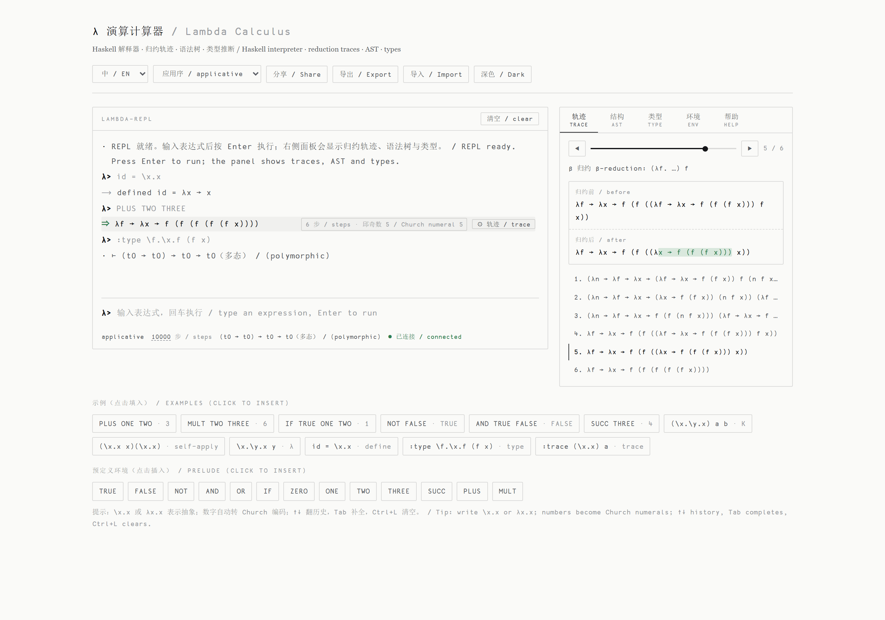
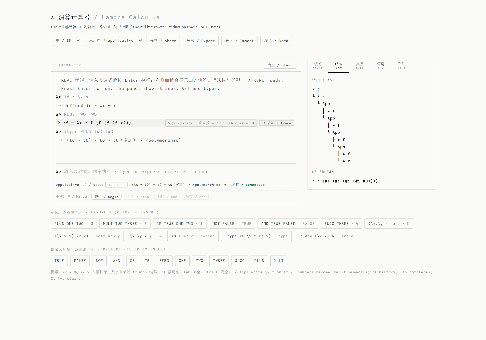
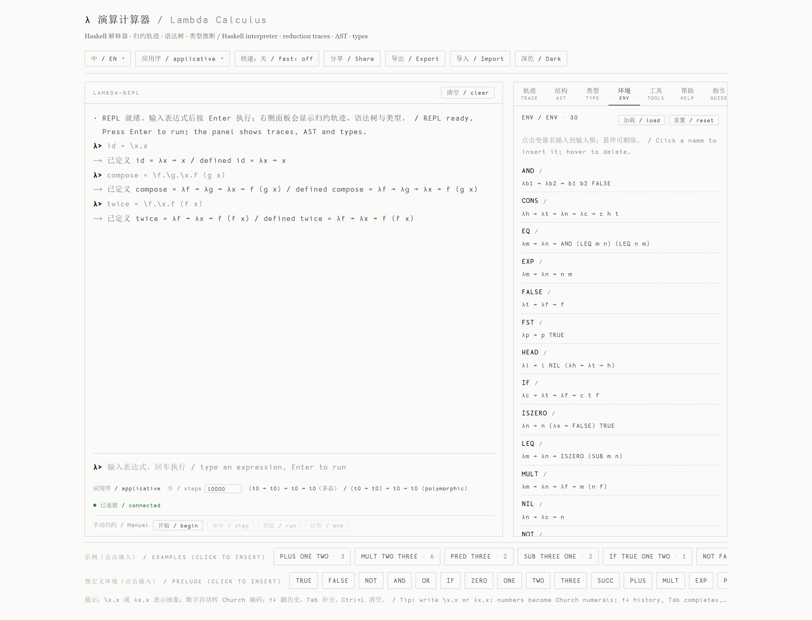
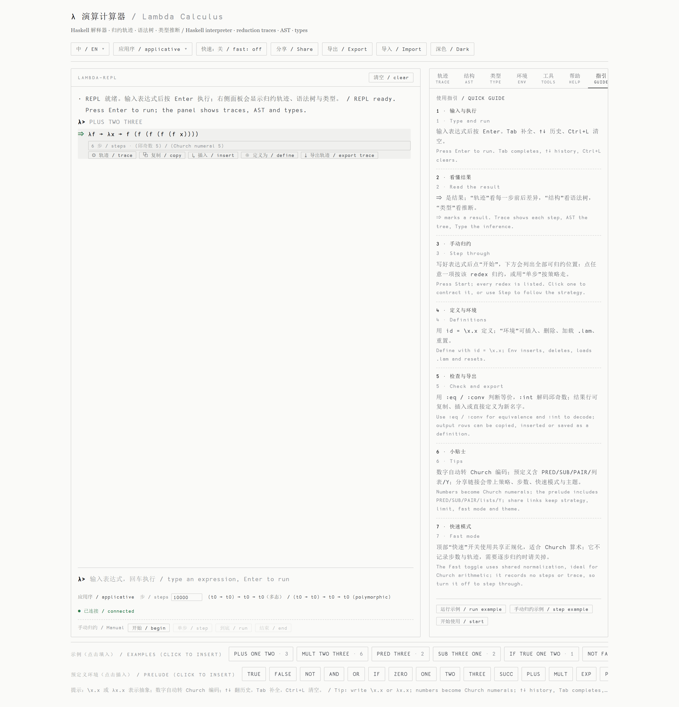

# Lambda Calculus Interpreter with Church Encoding ([中文版](./README-CN.md))

A Haskell implementation of pure lambda calculus: Church numerals, booleans,
pairs and lists, capture-avoiding substitution, reduction traces, four
evaluation strategies, eta reduction, simple type inference, and a small
definition environment. Two standalone interpreters are provided:

- `main` — the minimal core REPL.
- `extension` — definitions, file loading, traces, AST/de Bruijn views, types,
  redex picking, α/β equivalence checks, a batch/JSON mode for the web UI, and
  Chinese/English output.

## Online Demo

The enhanced interpreter runs in the browser at
**<http://47.116.114.77/lambda/>**. The page in `web/` is a thin Flask wrapper
around the same compiled `extension` binary.

## Features

- **Pure lambda calculus** with α-equivalence and capture-avoiding substitution.
- **Reduction traces** — every β/η step is recorded with its before/after term.
- **Four strategies** — applicative, normal, call-by-name, call-by-value
  (weak strategies stop at weak head normal form).
- **Eta reduction** — `:eta on|off` adds `λx. f x → f` when `x` is not free in `f`.
- **Fast mode** — `:fast on|off` (also a web toggle) evaluates with shared
  environments instead of rebuilding the whole term each step, which makes large
  Church arithmetic dramatically faster. It returns a normal form only: no
  trace and no exact step count, and `:steps` becomes a β fuel budget.
- **Normal forms** — `:nf` reduces to a full normal form, `:whnf` stops at the
  weak head normal form.
- **Redex picking** — `:begin` lists every β-redex; `:step <n>` contracts a
  chosen one. The web UI turns the list into clickable buttons.
- **Equivalence checks** — `:eq a , b` for α-equivalence, `:conv a , b` for
  β-convertibility (both sides reduced to normal form).
- **Step limit** (default 10,000) so non-terminating terms report instead of hang;
  `--timeout <s>` adds a wall-clock limit per command and `Ctrl+C` interrupts the
  current evaluation in the interactive REPL.
- **Semantic hints** — Church numerals/booleans/pairs and the `I K S B C W`
  combinators are recognised by α-equivalence.
- **Prelude** — `TRUE FALSE NOT AND OR IF ZERO ONE TWO THREE SUCC PLUS MULT EXP
  PRED SUB ISZERO LEQ EQ PAIR FST SND NIL CONS HEAD TAIL Y`.
- **Simple types** — Hindley–Milner inference with let-generalisation (`:type`).
- **Definitions** — `name = expr`, recursive `rec name = expr`, `:let`, `:load`,
  `:save`, `:env`, `:del`, `:reset`.
- **Definition files** — comments (`--` or `#`), indented/parenthesised
  continuation lines, and `:strategy` / `:steps` / `:lang` / `:fast` commands
  in `.lam`.
- **Integer bridge** — `:int <expr>` decodes a Church numeral, `:church <n>`
  encodes 0–9999.
- **Views** — pretty syntax tree (`:ast`), structured/collapsible AST in the web
  panel, and de Bruijn indices (`:db`).
- **Bilingual** — every user-facing message has a Chinese and an English form;
  `--lang zh|en|both` or `:lang` selects them (default `both`).

## Screenshots

Light theme, captured from the web UI.



*Reduction trace: every step with a before/after diff, a step player, and the
result annotated with its step count and Church-numeral value.*



*Syntax tree of the result, plus the de Bruijn index view for bound variables.*



*Environment panel: definitions are listed with their terms and types; click a
name to insert it, hover to delete it.*



*The built-in quick guide opens on the first visit and is always available from
the Guide tab.*

Regenerate them while the web UI is running:

```bash
pip install -r tools/requirements.txt
python tools/screenshot.py            # or: tools\screenshot.bat
```

## Building

```bash
./build.sh      # Linux / macOS
build.bat       # Windows
```

Both compile with `ghc -O2 ... -threaded -rtsopts`. The Windows script also
passes `-package containers -package haskeline -package directory`.

A Cabal file is provided for convenience; it builds the same two standalone
executables (no shared library, deliberately):

```bash
cabal build all
cabal run extension -- --help
```

## Usage

```bash
./extension [--lang zh|en|both] [--lang=zh] [--timeout 秒] [--batch] [--json] [-v|--version] [-h|--help] [file...]
```

If files are given, their definitions and commands are loaded in order before
the REPL. `test.lam` is a sample definitions file; its `ERR`/`ERROR` lines are
intentionally malformed so load-error reporting is exercised.

### REPL commands

| Command | Meaning |
| --- | --- |
| `:help` | show help |
| `:load <file>` | load definitions/commands (`name = expr`, comments, continuations) |
| `:save <file>` | save user definitions in parser-readable source syntax |
| `:let name = expr` / `:let rec name = expr` | define a variable / recursive definition |
| `:env` / `:del <name>` / `:reset` | inspect (with types) / delete / reset the environment |
| `:strategy applicative\|normal\|cbn\|cbv` | switch evaluation strategy |
| `:steps <n>` | set the reduction step limit |
| `:eta on\|off` | enable/disable eta reduction |
| `:fast on\|off` | shared fast normalization (normal form only, uses `:steps` as fuel) |
| `:trace <expr>` | print the full reduction trace |
| `:ast <expr>` / `:db <expr>` | syntax tree / de Bruijn indices |
| `:type <expr>` | infer the simple type |
| `:eq <a> , <b>` / `:conv <a> , <b>` | α-equivalence / β-convertibility |
| `:nf <expr>` / `:whnf <expr>` | full normal form / weak head normal form |
| `:int <expr>` / `:church <n>` | decode / encode a Church numeral |
| `:begin <expr>` / `:step [n]` / `:run` / `:end` | interactive reduction; `n` picks a redex |
| `:lang zh\|en\|both` | switch output language |
| `:q` | quit |

### Syntax

- Variables: start with a letter or one of `+ - * / % ^ ? ! < > | & ~ # $`,
  then letters, digits, `_`, `'`, or operators.
- Abstraction: `λx.body`, `λx → body`, or `\x -> body`; multiple parameters:
  `λx y.body`.
- Application: `f a`, left-associative; grouping: `(expr)`.
- Numbers: `0`…`9999` become Church numerals.
- Definitions: `name = expression`; recursion: `rec name = expression`.
- Equivalence commands separate the two expressions with a comma:
  `:eq \a.a , \b.b`.
- `.lam` files accept `--` or `#` comment lines and indented continuation lines.

### Examples

```text
λ> PLUS ONE TWO
⇒ λf → λx → f (f (f x))  (6 steps)  (Church numeral 3)

λ> :int (PRED THREE)
⇒ 2

λ> :eq \a.a , \b.b
⇒ alpha-equivalent: λa → a  ,  λb → b

λ> :conv PLUS ONE TWO , THREE
⇒ beta-equivalent: λf → λx → f (f (f x))  ,  λf → λx → f (f (f x))

λ> :eta on
λ> :nf \x. f x
⇒ f  (1 step)

λ> :begin (\x.x) ((\y.y) z)
λ> :step 2
⇒ (λx → x) z

λ> :type \f.\x.f (f x)
⊢ (t0 → t0) → t0 → t0 (polymorphic)

λ> :strategy normal
λ> (\x.y) ((\x.x x)(\x.x x))
⇒ y  (1 step)          -- normal order discards the argument

λ> :steps 40
λ> (\x.y) ((\x.x x)(\x.x x))
⚠ step limit 40 reached, reduction incomplete
```

## Web UI (`web/`)

`web/app.py` (Flask) keeps one persistent interpreter process per browser
session and speaks the `--batch --json` protocol.

- Terminal REPL with history, Tab completion, `Ctrl+L`, and error carets.
- Live panels for **reduction trace** (step player, play/pause, diff),
  **AST** (collapsible tree + text tree), **type**, and **environment**
  (click to insert, hover to delete, types shown for user definitions).
- **Tools** tab for `:eq`, `:conv`, `:nf`, `:whnf`, `:int`, `:church`, `:eta`,
  recursive definitions and `:save`; every command also works in the terminal.
- **Redex picker** under the terminal in manual mode: click any redex to
  contract it.
- **AST** panel with a collapsible tree and an **SVG graph** view.
- Output-row actions: copy, insert, define the result, and export the trace as
  Markdown.
- Strategy selector, step-limit control, share links (server-side short ids or
  a full `#state=` payload), `.lam` import/export, light/dark theme, and a
  Chinese/English/bilingual switch.
- **Small screens**: below 900px the layout becomes one scrolling column with a
  sticky tab bar and a capped terminal area; below 600px controls grow to 32px+
  targets, inputs use 16px so iOS does not zoom on focus, the tab bar divides the
  row evenly, and result-row actions stay visible on touch.
- Language switching uses `POST /api/session/<sid>/lang` and re-renders existing
  output locally from the server's `textZh`/`textEn` fields; it does not replay
  commands or start a new interpreter.
- `GET /api/prelude`, `GET /api/health`, `POST /api/share`,
  `GET /api/share/<id>`, `POST /api/session`, `POST /api/eval`
  (`{"session", "line"}`), `POST /api/session/<sid>/lang`, and
  `DELETE /api/session/<sid>`. The legacy `{"code": "..."}` form still works.
  A 408 response means the term timed out; a 410 means the session expired and
  the client should replay its history.
- `:load` is confined to the interpreter directory by default; the Env panel's
  **Load** button prompts for such a relative path. Set `LAMBDA_LOAD_ROOT=*`
  to allow any path (local use only).
- `:save` is disabled over the web by default; set `LAMBDA_ALLOW_SAVE=1` for
  local use. Client-side **Export** does not need the server.
- `HOST` and `PORT` override the default `127.0.0.1:8081`.
- Interpreter lookup: `$LAMBDA_INTERP_BIN`, `$LAMBDA_INTERP_DIR/extension[.exe]`,
  `<repo>/extension[.exe]`, `/opt/lambda-calculus-interpreter/extension`.
- `<base href="./">` keeps it working at `/` and behind the `/lambda/` prefix.
- `--batch` forces UTF-8; an interactive legacy Windows console may still garble
  Unicode, so use Windows Terminal or `chcp 65001` there.

```bash
pip install -r web/requirements.txt
python web/app.py          # http://127.0.0.1:8081
```

## Batch and JSON protocol

`--batch` reads one command per stdin line and prints `\x1e` after each result.
`--json` makes every output a JSON object:

```json
{"kind":"result","text":"...","textZh":"...","textEn":"...",
 "term":"λf → λx → f x","steps":6,
 "limitHit":false,"hint":"...","hintZh":"...","hintEn":"...",
 "typeZh":"...","typeEn":"...","strategy":"applicative","eta":false,
 "ast":["λ x","└ • x"],"db":"λ.λ.#0",
 "redexes":[{"i":1,"path":"root","term":"...","rule":"β"}],"redexCount":1,
 "trace":[{"n":1,"rule":"β","note":"...","before":"...","after":"..."}],
 "traceShown":1,"traceTruncated":false}
```

Traces keep at most 500 steps in memory and clip long terms to 300 characters;
`traceTruncated` tells the client when either limit applied. Structured
`astTree` is emitted for terms up to 400 nodes and replaced by
`astTreeOmitted: true` for larger ones. `redexes` is capped at 200 entries while
`redexCount` is exact.

`--batch` also forces UTF-8 on stdin/stdout/stderr, which removes the old
Windows code-page workaround.

## Tests

There is no Cabal/Stack project, so the test suite drives the compiled binary
end-to-end through the JSON protocol:

```bash
./test.sh          # Linux / macOS
test.bat           # Windows
python tests/run_tests.py --bin ./extension
```

31 groups cover parsing positions, β-reduction results, capture avoidance,
traces, all four strategies, step limits, Church/combinator hints, type
inference, environment commands, file loading (comments, continuations,
commands, line numbers, save/reload, recursion, multiple files), manual
reduction and redex picking, normal forms, eta and fast mode, α/β equivalence,
integer encoding, AST/de Bruijn, bilingual output, JSON protocol, determinism,
cross-strategy agreement, trace capping, CLI options, web API sessions,
expiry/language switching/health checks, short share links, bilingual protocol
fields, wall-clock timeout, randomized properties, and a `main`/`extension`
differential test.

## Implementation

- A small-step evaluator contracts one β-redex per step and rewrites the whole
  term, so each recorded trace step is a real before/after pair. Strategies are
  described by four flags.
- Eta is a second rule tried after β; weak strategies do not reduce under
  lambdas. `:nf` uses normal order, `:whnf` stops as soon as a head normal form
  is reached.
- Redexes are enumerated by path (`[Int]`), so any β-redex can be contracted by
  index without changing the evaluator.
- Capture-avoiding substitution computes the argument's free variables once,
  shares subtrees that do not contain the substituted variable, and reports
  whether any α-renaming happened. α-equivalence walks both binding
  environments in lockstep, with no intermediate de Bruijn tree.
- Fast mode converts the expanded term to de Bruijn form and normalizes it with
  an environment/closure evaluator (`FastM`); shared arguments are evaluated
  once. `:steps` is read as a β fuel budget, so divergent terms still stop.
- Pretty printers build `ShowS` functions, and `shorten` forces only the first
  characters of a lazy string, so clipping a huge term does not print it first.
- Types are inferred with Hindley–Milner and let-generalisation.
- Definitions are stored already expanded; recursive definitions are encoded as
  `Y (λname. body)` and printed/saved as `rec name = body`.
- The web backend keeps one interpreter process per session; expired sessions
  return 410 so the client replays its history rather than silently losing the
  environment.

## Conventions

- Chinese text uses the full-width Chinese quotes `“ ”`; English text uses ASCII
  `"` and `'`. The corner brackets U+300C and U+300D are never used, here or in
  code, comments, or UI strings.

## Limitations

- Substitution copies terms; terms with heavy duplication (for example `rec
  fact` under applicative order) can grow exponentially. Use fast mode, a
  smaller `:steps`, normal order, or accept the cost.
- Fast mode always computes a normal form: it ignores the selected strategy and
  η, records no trace, and reports no exact step count. `:trace`, `:whnf` and
  manual stepping always use the step-by-step engine.
- The CLI REPL has no wall-clock limit by default; pass `--timeout <s>` to set
  one, or use `Ctrl+C`. The web backend enforces its own timeout by killing the
  session.
- `:save` is intentionally unavailable over the web unless explicitly enabled.
- The parser reports one error per expression; `:eq`/`:conv` combine errors from
  both sides, and `.lam` loading reports every failing line.

## License

MIT. See [LICENSE](./LICENSE).
