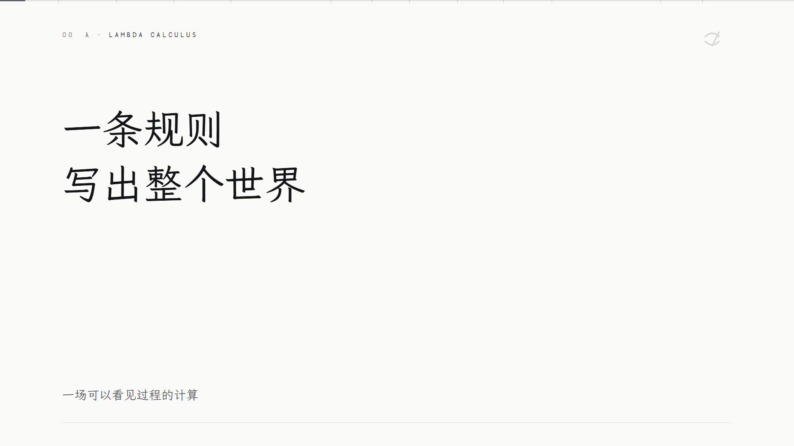
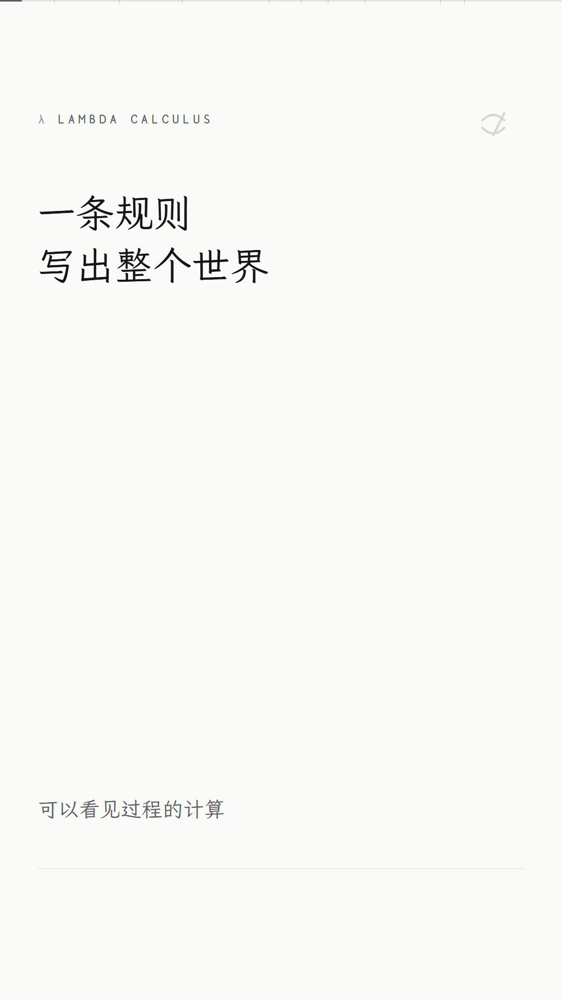

# 宣传片 / Promo films

两条宣传片，**画面全部来自实机浏览器录屏**，不是重绘的界面。
Both films use **real browser screencasts** of the running web UI — no redrawn mockups.

| 哔哩哔哩长屏版 | 抖音短视频版 |
| --- | --- |
|  |  |

| 版本 | 画幅 | 时长 | 成片 |
| --- | --- | --- | --- |
| 哔哩哔哩长屏版 | 1920×1080 · 16:9 | 95 秒 | [`out/bilibili.mp4`](./out/bilibili.mp4) |
| 抖音短视频版 | 1080×1920 · 9:16 | 52 秒 | [`out/douyin.mp4`](./out/douyin.mp4) |

界面语言固定为**中文**，页脚示例与无关控件在采集时隐藏，保持画面简洁。
The UI is forced to Chinese; the example footer and unrelated controls are hidden
during capture so the frame stays calm.

## 一键复现 / Reproduce

```bash
# 1. 采集体素材（自动启动 web/app.py；Chrome + ChromeDriver 需已安装）
npm run capture

# 2. 只采某一个平台 / one platform only
npm run capture:bili
npm run capture:douyin

# 3. 渲染 / render
npm run render:bili
npm run render:douyin
```

采集脚本也可以用 Python 直接调用：

```bash
python scripts/browser_capture.py --profile both --start-server
python scripts/browser_capture.py --profile bili --only trace --kind clip --keep-frames
python scripts/browser_capture.py --list          # 列出全部场景
```

## 采集脚本 / Capture script

[`scripts/browser_capture.py`](./scripts/browser_capture.py) 用 Selenium 驱动本机
Chrome，通过 CDP `Page.startScreencast` 抓帧，ffmpeg 编码为定帧率 MP4。
全部操作都是真实点击与键盘输入：逐字敲命令、切换标签、拖动轨迹、点开工具对话框。
It drives Chrome through Selenium, grabs frames with CDP `Page.startScreencast`
and encodes them with ffmpeg. Every action is a real click or keystroke: typing
commands, switching tabs, dragging the trace slider, opening tool dialogs.

两套取景配置 / Two framing profiles:

- `bili`：1280×720 CSS 视口 @1.5x → 1920×1080，终端与检查器并排
- `douyin`：540×960 CSS 视口 @2x → 1080×1920，窄屏单列；每个场景用
  `frame("inspector")` 滚动到检查器，让轨迹、AST、类型落在安全区内

场景清单 / Scenes: `cover`（静帧）、`intro`、`trace`、`manual`、`ast`、`type`、
`env`、`race`、`fast`、`guide`。素材与 `manifest.json` 落在
`public/real/{bili,douyin}/`。

注意：Remotion 渲染竖屏素材时建议 `--concurrency=2`；脚本已用固定关键帧
重新编码竖屏片段，避免 compositor 在 1080×1920 上 seek 失败。
Use `--concurrency=2` for the vertical render; the vertical clips are re-encoded
with regular keyframes to avoid compositor seek failures at 1080×1920.

## 剪辑结构 / Editing

[`src/FootageFilm.tsx`](./src/FootageFilm.tsx) 定义两条片的段落：
`Footage` 播放真实录屏并叠加中文字幕，`ChapterCard` 是纯纸面概念转场。
旧的逐帧绘制版 [`LambdaPromo`](./src/LambdaPromo.tsx) 仍保留，可继续单独渲染。

字体、环境音与旧版相同。片中数值、归约步数、类型都来自解释器的真实输出。
完整旁白稿在 [`SCRIPT.md`](./SCRIPT.md)。

## 依赖 / Requirements

```bash
pip install selenium websocket-client
```

本机需要 Chrome、与版本匹配的 ChromeDriver（在 PATH 或常见安装目录），
以及 PATH 中的 ffmpeg。可用 `CHROME_BIN` / `CHROMEDRIVER_BIN` 指定路径。
Need Chrome, a matching ChromeDriver and ffmpeg on PATH; `CHROME_BIN` and
`CHROMEDRIVER_BIN` override discovery.
